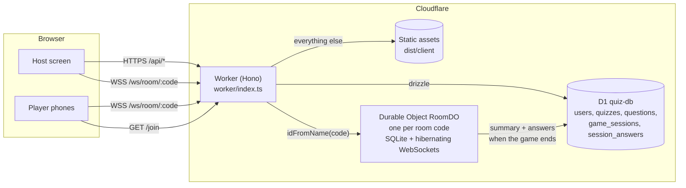

# Architecture

OpenLearn is three pieces: a React single-page app, a thin Cloudflare Worker that serves it and handles the JSON API, and one Durable Object per game room that owns everything live. D1 (Cloudflare's SQLite database) stores accounts, quiz content and finished-game history.



## Pieces

| Piece | Where | Role |
| --- | --- | --- |
| SPA | `src/` | React 18, Vite, Tailwind, react-router, TanStack Query. Built to `dist/client` and served as static assets with SPA fallback. |
| Worker | `worker/index.ts` | Hono app. `/api/auth`, `/api/quizzes`, `/api/sessions`, `/api/health`, and `/ws/room/:code`, which forwards the WebSocket upgrade to the room's Durable Object. Everything else goes to the `ASSETS` binding. |
| Room | `worker/room/RoomDO.ts` | One Durable Object instance per 6-digit room code (`ROOM.idFromName(code)`). Holds players, answers and game state in its own SQLite, runs the question timer with an alarm, and talks to every connected browser over WebSockets. |
| Game rules | `worker/room/machine.ts`, `worker/room/scoring.ts` | Pure functions: what the player is allowed to see of a question, whether an answer is correct, points, ranking. Unit tested without the runtime. |
| D1 | `worker/db/schema.ts`, `drizzle/` | Durable data: users, quizzes, questions, game_sessions, session_answers. Accessed with drizzle. |
| Shared contract | `src/shared/schemas.ts`, `src/shared/types.ts` | Zod schemas for question configs and every inbound WebSocket message; TypeScript types for every outbound event. Imported by both the SPA and the Worker. |

## How a game flows

1. **Host creates a room.** The host screen calls `POST /api/sessions {quizId, mode, isTeam, teamCount}`. The Worker loads the quiz and its questions from D1, draws a random 6-digit PIN (`worker/room/roomCode.ts`, retried if the PIN is already in `game_sessions`), mints a `sessionId` and a `hostToken`, and calls the room's `/init` with the questions and settings. It then inserts a `game_sessions` row and returns `{sessionId, roomCode, hostToken}`. The host tab stores `hostToken` in `sessionStorage` and navigates to `/host/:sessionId/:code`.
2. **Everyone connects.** Host and players open `wss://<host>/ws/room/<code>`. The Worker validates the code and hands the upgrade to the Durable Object, which accepts the socket with `ctx.acceptWebSocket` (Hibernation API), stores a random connection id in the socket's attachment, and sends `WELCOME` with the current players, teams, phase and a snapshot. A room that was never initialised (or has already finished) answers 409 `Room not initialized`, which the client shows as "Room not found".
3. **Players join.** `JOIN {nickname, teamId?}` while the phase is `lobby`. The room checks the nickname (1 to 20 characters, unique in the room), the player cap (200), and the team if team mode is on, inserts a `players` row, replies `JOINED {playerId, sessionId}` and broadcasts `LOBBY_UPDATE`. The player saves `{sessionId, playerId, roomCode}` in `localStorage` so a reload can send `RECONNECT {playerId}` and get `RECONNECTED` with the current score and snapshot.
4. **Host starts.** `HOST_START {hostToken}`. Every host message carries the token and is ignored (with an `ERROR` reply) if it does not match the one given at `/init`. The room sets `phase = question`, records `questionStartedAt` and `endsAt`, sets a Durable Object **alarm** for `endsAt`, and broadcasts `QUESTION_STARTED` with the public view of the question (correct flags stripped, puzzle items shuffled) plus `serverTime` so clients can correct their clocks.
5. **Players answer.** `ANSWER {questionId, answer}`. Accepted only during `question`, not paused, within 500 ms grace after `endsAt`, once per player per question. The room evaluates it, computes points, updates the player's score and streak, replies `ANSWER_ACK` and `PLAYER_RESULT` (own points and, in team mode, the team total), and broadcasts `ANSWER_COUNT`. If every connected player (plus anyone who dropped in the last 10 seconds) has answered, the room reveals immediately instead of waiting for the timer.
6. **Reveal.** Triggered by the alarm, by the auto-reveal above, or by `HOST_SKIP`. The room deletes the alarm, sets `phase = reveal`, and broadcasts `QUESTION_REVEALED` with the correct answer, the answer distribution and the top-5 standings (players, or teams in team mode). Each player's socket also gets a private `YOUR_STANDING` with their rank, total players and the gap to the person above.
7. **Next or finish.** `HOST_NEXT` starts the next question or, after the last one, finishes. `HOST_END` finishes at any time. `HOST_PAUSE` and `HOST_RESUME` stop and restart the timer; resume shifts `questionStartedAt` forward so the paused interval does not count against speed scoring. `HOST_KICK` removes a player, deletes their answers and closes their socket with code 4001.
8. **Finish.** `GAME_FINISHED` with the podium (top 3), a final `YOUR_STANDING` to each player, then a single `D1.batch` that updates the `game_sessions` row (`ended_at`, `summary_json`) and inserts one `session_answers` row per answer. Only if that succeeds does the room delete its own players, teams, answers and state. If the write fails, the data stays in the room and an error is logged.

The host's history pages (`/sessions`, `/sessions/:id`, `GET /api/sessions/:id/export.csv`) read only from D1.

## What lives where, and why

**In the room's SQLite (Durable Object storage):**

- `players` (id, nickname, score, streak, connected, connection_id, team_id, disconnected_at)
- `teams` (id, name, color)
- `answers` (player_id, question_id, payload, latency_ms, is_correct, points)
- `room_state` (a single JSON row with phase, current index, questions, timer and settings)

A Durable Object is single-threaded and lives in one place, so "has this player already answered", "has everyone answered" and "what is the score" are plain local SQL with no races and no network round trip. The room must stay inside a 10 ms CPU budget per message on the free plan, and D1 calls would eat that. The data is also naturally scoped: a room never needs another room's answers.

**In D1:**

- `users`, `quizzes`, `questions`: accounts and content. Needed across rooms and across time, edited by the host, queried by owner.
- `game_sessions`, `session_answers`: history and export. Written once, at the end, in one batch.

D1 is the right place for anything a host lists, searches or exports later. It is the wrong place for a write per player per second during a game.

**Hibernation.** Idle rooms (everyone waiting for the host) are evicted from memory while their WebSockets stay open; Cloudflare wakes the object when a message or alarm arrives. That is why nothing is kept on the `WebSocket` object itself: the per-socket connection id is in `serializeAttachment`, and all state is in SQLite. Any field you add to `RoomDO` as a class property will be lost on wake.

## Game phases

The room moves through these phases (`GamePhase` in `src/shared/types.ts`):

```
lobby --HOST_START--> question --alarm / all answered / HOST_SKIP--> reveal --HOST_NEXT--> question ...
                        |                                               |
                 HOST_PAUSE / HOST_RESUME                 last question, or HOST_END at any time
                                                                        v
                                                                     finished
```

`countdown` and `scoreboard` exist in the type for future use; the room does not emit them today.

## Scoring

`worker/room/scoring.ts`, chosen per room by the game mode:

- **classic**: `points = floor(maxPoints * (1 - ratio / 2))` for a correct answer, where `ratio = clamp(latency / timeLimit, 0, 1)`. Instant answer: 100 % of the question's points; at the buzzer: 50 %. Wrong: 0.
- **accuracy**: full `maxPoints` if correct, else 0. Speed is ignored.
- **lecture**: nothing is scored.

`latency` is measured by the room (`now - questionStartedAt`), not by the phone, and capped at the time limit. `poll`, `slide` and `scale` never score (`UNSCORED_TYPES` in `machine.ts`). A player's `streak` increments on a correct answer and resets on a wrong one; it is shown but does not change points. Team score is the sum of members' scores.

Ranking (`rankEntries`) uses competition ranking: tied scores share a rank and the next rank is skipped (1, 2, 2, 4). `behind` is the nearest entry with a strictly higher score and the gap to it, so first place has none.

## Question types

Configs are the zod discriminated union `QuestionConfigSchema` in `src/shared/schemas.ts`. `publicConfig` in `machine.ts` decides what players see; `evaluateAnswer` decides correctness; `getCorrectAnswer` is what the reveal shows.

| Type | Config | Player sends | Correct when |
| --- | --- | --- | --- |
| `quiz` | 2 to 4 choices, one `isCorrect` | choice id | the id is the correct one |
| `multi_select` | 2 to 6 choices, several `isCorrect` (`partialCredit` flag exists but is not applied) | array of ids | the set equals the correct set exactly |
| `true_false` | `correct: boolean` | boolean | equal |
| `type_answer` | `acceptedAnswers[]`, `caseSensitive` | string | trimmed (and lower-cased unless case sensitive) text matches an accepted answer |
| `puzzle` | 3+ items, `correctOrder` of ids; players receive the items shuffled | array of ids | same length and order |
| `poll` | 2+ choices | choice id | never scored |
| `slide` | `body` text | nothing | never scored |
| `slider` | `min`, `max`, `step`, optional `correct`, `tolerance` | number | `abs(answer - correct) <= tolerance`; a slider without `correct` is never correct |
| `drop_pin` | `imageUrl`, `correctX`, `correctY` (0 to 1), `tolerance` (default 0.1) | `{x, y}` | Euclidean distance to the correct point is within `tolerance` |
| `scale` | `minLabel`, `maxLabel`, `steps` (3 to 7) | number | never scored |

Every question also has `prompt` (up to 500 chars), `timeLimitSec` (5 to 240, default 20) and `points` (0 to 2000, default 1000), validated in `worker/api/quizzes.ts`.

## Adding a question type

Work through these files in order; TypeScript will point at anything you miss because the unions are exhaustive.

1. `src/shared/schemas.ts`: add the name to `QuestionType` and a branch to `QuestionConfigSchema`.
2. `src/shared/types.ts`: add a `PublicConfig` variant (what players may see) and, if the reveal needs a new shape, a `CorrectAnswer` variant.
3. `worker/room/machine.ts`: handle it in `publicConfig`, `evaluateAnswer` and `getCorrectAnswer`; add it to `UNSCORED_TYPES` if it should never score.
4. `src/features/quiz-editor/QuestionForm.tsx`: a label in the type list, a default in `defaultConfigFor`, and the editing fields.
5. `src/features/player/AnswerInput.tsx`: the input the player uses.
6. `src/features/host/HostGame.tsx`: how the host screen shows the question and its reveal.
7. Optional: `src/features/quiz-import/parseQuiz.ts` if it should be importable from a spreadsheet (`TYPE_ALIASES` and the `switch` on type).
8. Tests: `tests/unit/machine.test.ts` for evaluation, `tests/unit/parseQuiz.test.ts` if imported.

No database change is needed: `questions.config` is a JSON column and `questions.type` is free text.

## WebSocket messages

Inbound (client to room), all validated by `ClientEventSchema`; messages over 8 KiB or that fail validation get an `ERROR` with code `BAD_MESSAGE`:

`JOIN`, `RECONNECT`, `ANSWER`, `HOST_START`, `HOST_NEXT`, `HOST_SKIP`, `HOST_PAUSE`, `HOST_RESUME`, `HOST_KICK`, `HOST_END`.

Outbound (room to clients), typed as `ServerEvent`:

`WELCOME`, `JOINED`, `RECONNECTED`, `LOBBY_UPDATE`, `QUESTION_STARTED`, `ANSWER_ACK`, `ANSWER_COUNT`, `PLAYER_RESULT`, `QUESTION_REVEALED`, `YOUR_STANDING`, `GAME_FINISHED`, `PLAYER_KICKED`, `PAUSED`, `RESUMED`, `ERROR`.

The client hook `src/lib/useRoomSocket.ts` reconnects with exponential backoff (up to 5 attempts, at most 8 s apart), treats close code 4001 as "removed by the host", and gives up with "Room not found" if the first connection never opens.

## Auth design

Hosts sign in with email and password (`/register`, `/login`). Players never sign in.

- **API:** `POST /api/auth/register {email, password, displayName}`, `POST /api/auth/login {email, password}`, `POST /api/auth/logout`, `GET /api/auth/me`. `/api/quizzes/*`, `/api/sessions/*` and `/api/auth/me` require a session (`requireAuth` in `worker/api/auth.ts`). Passwords are 8 to 128 characters.
- **Passwords:** PBKDF2-SHA256 via WebCrypto, 16-byte random salt, stored in `users.password_hash` as `pbkdf2$<iterations>$<saltB64>$<hashB64>`. The iteration count is **30,000** (`PBKDF2_ITERATIONS` in `worker/auth/crypto.ts`). Workers caps PBKDF2 at 100,000, and the free plan allows 10 ms CPU per request; 100k measured about 12 ms on a fast desktop, 30k about 3.5 ms, which leaves headroom for slower edge CPUs. That is well below OWASP's 600k recommendation; on a paid plan raise the constant (max 100k). Existing hashes keep working and are re-hashed on the user's next login. Login hashes against a dummy hash for unknown emails so timing does not reveal which accounts exist.
- **Sessions:** stateless HMAC-SHA256-signed cookie `session=v1.<base64url {u: userId, e: expiryMs}>.<base64url sig>`, `HttpOnly; SameSite=Lax; Path=/; Max-Age=30 days`, plus `Secure` over https. The key is the `SESSION_SECRET` secret (`.dev.vars` locally, `npx wrangler secret put SESSION_SECRET` in production). If it is missing or shorter than 32 characters, auth endpoints return 500 and log why. Logout only clears the cookie; there is no server-side revocation. Rotating `SESSION_SECRET` signs everyone out.
- **CSRF:** non-GET `/api/*` requests with an `Origin` header that does not match the host are rejected with 403 (`checkOrigin`); `SameSite=Lax` covers the rest.
- **Host control inside a room** is the per-room `hostToken` (a UUID returned when the room is created), not the login cookie. It lives in the creating tab's `sessionStorage`.
- The seeded `dev-user` row (password hash `!`) cannot log in.

Roadmap: account creation is planned to move to Microsoft SSO (Entra ID). The password flow is a stopgap.

## Limits baked into the code

| Constant | Value | Where |
| --- | --- | --- |
| Players per room | 200 | `MAX_PLAYERS`, `RoomDO.ts` |
| WebSocket message size | 8 KiB | `MAX_MESSAGE_CHARS`, `RoomDO.ts` |
| Late-answer grace | 500 ms | `ANSWER_GRACE_MS`, `RoomDO.ts` |
| Disconnected player still "expected to answer" | 10 s | `RECONNECT_GRACE_MS`, `RoomDO.ts` |
| Nickname | 1 to 20 chars | `JoinPayloadSchema` and `handleJoin` |
| Room PIN | 6 digits | `roomCode.ts` |
| Teams | 2 to 4 (Red, Blue, Yellow, Green) | `TEAM_DEFS`, `RoomDO.ts`; `CreateSessionSchema`, `sessions.ts` |
| Session cookie lifetime | 30 days | `SESSION_TTL_SEC`, `auth.ts` |
